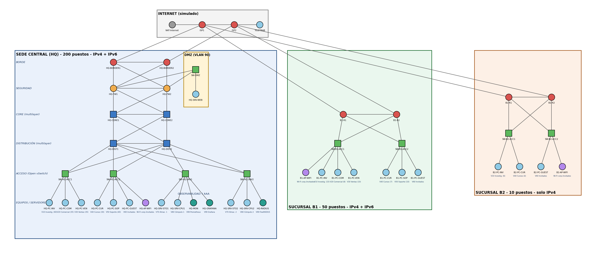

# RAC - Red corporativa (HQ + B1 + B2) en GNS3

Trabajo final de *Redes de Acceso y Corporativas* (grupo Javi / Pepe / Manu): diseño de una red corporativa de tres sedes, simulada en GNS3 con routers MikroTik CHR, y configurada **mediante scripts** (infraestructura como código).



## Estado del trabajo

| Fase | Contenido | Estado |
|---|---|---|
| 1 | Direcciones IPv4/IPv6 de los enlaces, loopbacks, WAN con dos ISP | **Hecha y probada**: 49/49 pruebas de ping OK (08/11/2026) |
| 2 | OSPFv2/OSPFv3 en HQ (+ BFD opcional) | Scripts generados (`02_ospf.rsc`, `03_bfd_opcional.rsc`), **sin probar** |
| 3 | VLAN, RSTP, VRRP, DHCP, gateways de cada departamento | Pendiente |
| 4 | NAT, firewall, DMZ, política Zero Trust entre zonas | Pendiente |
| 5 | Túneles WireGuard B1/B2 y teletrabajo; OSPF en B1/B2 | Pendiente |
| 6 | Observabilidad (Prometheus, Grafana) y autenticación (FreeRADIUS) | Pendiente (nodos creados, sin configurar) |
| 7 | Pruebas de fallo y cálculo de disponibilidad; informe final | Pendiente |

Lo marcado como pendiente es el **plan**, no algo ya hecho.

## Qué es la red

- **HQ** (200 puestos): 2 routers de borde, 2 firewalls (CHR), 2 core, 2 distribución multicapa, 3 switches de acceso y 2 de servidores (Open vSwitch), DMZ.
- **B1** (50 puestos) y **B2** (10 puestos): 2 routers cada una (borde + L3) y 2 switches de acceso.
- **Internet simulado**: ISP1 e ISP2 interconectados; cada sede tiene un enlace por proveedor. ISP1 da salida real por el NAT de GNS3.
- 51 nodos (14 CHR, 9 Open vSwitch, 23 hosts Alpine, servicios Docker) y 71 enlaces. **Todo duplicado** salvo los equipos finales.
- **Objetivo de disponibilidad 0,999** (≈ 8,76 h/año de caída). Es un objetivo **nuestro**: el enunciado solo pide «disponibilidad» sin cifra. Se estimará con un modelo y se contrastará con pruebas de fallo (fase 7); **aún no está demostrado**.

### Direccionamiento (fase 1, ya aplicado)

| Elemento | Plan |
|---|---|
| Loopbacks HQ | `10.1.254.N/32` y `fdce:f6ae:a8d8:10fe::N/128` (BORDER1=1, BORDER2=2, FW1=3, FW2=4, CORE1=11, CORE2=12, DIST1=21, DIST2=22) |
| Enlaces HQ | 16 enlaces `/30` en `10.1.255.0/24` y `/127` en `fdce:f6ae:a8d8:10ff::/64` (tabla completa en `configs/HA_fase1/LEEME_fase1_HA.md`) |
| WAN | `203.0.113.0/24` y `2001:db8:ffff::/48` (documentación, RFC 5737/3849) |
| B1 / B2 | `10.2.0.0/16` / `10.3.0.0/16`; B2 solo IPv4 |
| Internas IPv6 | ULA `fdce:f6ae:a8d8::/48` |

Los rangos de VLAN y direcciones de usuarios (fases 3 en adelante) están en el informe técnico y **pendientes de confirmar** en grupo.

## Requisitos

- **GNS3 2.2.x** (GUI) y **GNS3 VM** en VMware, con virtualización anidada/KVM. Recomendado: **8 GB de RAM y 4 vCPU** (`Edit → Preferences → GNS3 VM`). Con 2 GB los 14 routers no arrancan.
- **Imagen de MikroTik CHR 7.22.1** (`chr-7.22.1.img`): **no está en el repositorio**. Se descarga de <https://mikrotik.com/download> y se importa con `File → Import appliance → mikrotik-chr.gns3a` (viene con GNS3) eligiendo la versión 7.22.1 y el servidor GNS3 VM. Sin esa imagen el proyecto **no abre** (GNS3 aborta si falta una).
- Las imágenes Docker (`alpine`, `gns3/openvswitch`, `nginx:alpine`, `prom/prometheus`, `grafana/grafana`, `freeradius/freeradius-server`) las usa el GNS3 VM; si no las tiene, GNS3 intenta descargarlas al arrancar el nodo.
- **Python 3.8+** (solo biblioteca estándar) y **git**.
- Licencia gratuita del CHR: **1 Mbps por interfaz**. Sirve para conectividad y recuperación, **no** para medir rendimiento ([manual MikroTik](https://manual.mikrotik.com/docs/getting-started/routeros-licensing/chr/chr-licensing/)).

## Puesta en marcha

1. Clona el repositorio (o `Code → Download ZIP`) y abre GNS3.
2. Importa el CHR (ver Requisitos) y comprueba el GNS3 VM (8 GB / 4 vCPU).
3. `File → Open project` → `RAC_Red_HA/RAC_Red_HA.gns3`.
4. Arranca los routers (▶ Start all). Espera 2-3 minutos. En el primer arranque cada CHR pide cambiar la contraseña (usuario `admin`, clave vacía).
5. Anota la **IP del GNS3 VM** (columna *Console* de *Topology Summary*, p. ej. `192.168.196.128`). Si es distinta, usa `--host IP` o la variable de entorno `GNS3_HOST`.
6. En la carpeta `configs/HA_fase1`:
   ```
   python push_config.py 01 --dry-run     # solo muestra qué haría
   python push_config.py 01               # aplica las direcciones a los 14 routers
   python test_fase1.py                   # lanza las 49 pruebas de ping y guarda un informe en logs/
   ```
   La contraseña de `admin` se pide por teclado (o `RAC_PASS`) y **no se guarda**. Cierra antes las ventanas de consola de los routers: solo admiten un cliente.
7. Para apagar: `Control → Stop all nodes`, esperar a que todos estén en rojo, `File → Save project` y entonces salir.

## Estructura

```
RAC_Red_HA/RAC_Red_HA.gns3      proyecto de GNS3 (topología)
configs/HA_fase1/
  <router>/01_direcciones.rsc   direcciones, loopback, WAN
  <router>/02_ospf.rsc          OSPFv2/v3 (solo HQ)
  <router>/03_bfd_opcional.rsc  BFD (tras comprobar OSPF)
  push_config.py                envía un .rsc a los routers por su consola telnet
  test_fase1.py                 pruebas de ping automáticas + informe
  tests_fase1.json              lista de pruebas
  LEEME_fase1_HA.md             pruebas manuales y tabla de enlaces
topologia_HA.png                esquema
Informe_final_RAC.pdf           memoria técnica (versión 4: diseño, estado y pasos pendientes)
informe/                        fuentes LaTeX del informe (compilar con XeLaTeX) y tablas generadas
```

## Reglas para trabajar en equipo

- `git pull` antes de empezar y `git push` al terminar. Mensajes de commit que digan **qué** se hizo.
- **Una sola persona edita el `.gns3`** a la vez: GNS3 lo reescribe entero (puertos de consola, posiciones) y dos cambios simultáneos dan conflictos. Quien lo cambie, lo avisa por el grupo.
- Los cambios de configuración van en los `.rsc` (o en el generador), **no** solo dentro del router: los discos de los routers viven en el GNS3 VM de cada uno y **no** están en el repositorio.
- **Nunca** subir contraseñas, ni ficheros `.env`, ni el enunciado, ni trabajos de otros grupos (el `.gitignore` ya excluye lo conocido).
- Los `.rsc` y el proyecto se generan con un script que **no** está aún en el repositorio; si se necesita regenerar, pedirlo a Javi. No regenerar el `.gns3` con el proyecto abierto en GNS3 (lo pisa).

## Limitaciones conocidas

- Los scripts de la fase 2 en adelante **no están probados** en el router real. Cualquier error de sintaxis de RouterOS: copiad el mensaje exacto.
- Que un comando se acepte no prueba que funcione: se valida siempre con ping/traceroute (`test_fase1.py`).
- La persistencia de la configuración al cerrar y reabrir GNS3 está **por comprobar**.
- OPNsense (IPS/IDS) no está integrado: los firewalls son CHR. Pendiente de decidir (necesita imagen de ~3 GB).

## Reparto propuesto (pendiente de confirmar)

| Persona | Bloques |
|---|---|
| Javi | Interior de HQ, direccionamiento, base de automatización |
| Pepe | Perímetro, firewall, WireGuard, DMZ |
| Manu | Observabilidad, RADIUS, B1/B2, pruebas |

## Referencias

- Gill, Jain, Nagappan. *Understanding Network Failures in Data Centers*. SIGCOMM 2011: <https://people.cs.umass.edu/~phillipa/papers/comm235-gill.pdf>
- Turner, Levchenko, Snoeren, Savage. *California Fault Lines*. SIGCOMM 2010: <https://people.cs.umass.edu/~phillipa/CSE390/calfault.pdf>
- Temario *Diseño de Redes* (DDR), Tema 2: topología, redundancia, disponibilidad.

## Estado actual – Fase 1: LAN de HQ (IPv6)

> **Variante "solo IPv6", pendiente de confirmar con el profesor.** Se trabaja en la rama `ipv6-solo` y la configuración está en `configs/IPv6_fase1/`. **No sustituye** a `configs/HA_fase1/` (doble pila, de Javi): si el profesor confirma doble pila, se vuelve a esa. Las diferencias entre las dos están en `configs/IPv6_fase1/LEEME_IPv6.md`.

### Cómo trabajar con esta variante
1. `git pull` en la rama `ipv6-solo` antes de empezar.
2. Abrir **siempre** `RAC_Red_HA/RAC_Red_HA.gns3` de este repositorio. No usar copias en otras carpetas: tienen el mismo identificador de proyecto y GNS3 se confunde.
3. Las configuraciones viven en el GNS3 VM (discos de los CHR, `/etc/openvswitch` de los OVS y *Edit config* de los PCs); en el repositorio se guardan como copia en `configs/IPv6_fase1/`. Si un equipo se rompe, se pega su fichero y queda igual.
4. Para cerrar: *Stop all nodes* → esperar a que todos estén en rojo → *File → Save project* → salir. Si el `.gns3` ha cambiado, subirlo y avisar al grupo, porque solo una persona puede editarlo a la vez.

### Decisiones de diseño
- **HQ y B1 solo con IPv6, B2 solo con IPv4.** La interconexión o traducción entre ellas se decidirá más adelante.
- Prefijo de HQ: `2001:db8:1::/48` (prefijo de documentación, al ser un entorno simulado).
- Una `/64` por VLAN, con el número de la VLAN en el 4.º bloque (`2001:db8:1:<vlan>::/64`) para que sea fácil de leer.
- **SLAAC** para los PCs (asignación dinámica, sin servidor: los DIST envían los RA) y direcciones **estáticas** para servidores y AP.
- Arquitectura jerárquica: **acceso (Open vSwitch) → distribución (HQ-DIST1/2) → core → FW → borde**, con todos los equipos duplicados.

### VLANs de HQ
| VLAN | Nombre | Prefijo IPv6 | Asignación |
|---|---|---|---|
| 10 | INVESTIGACION | `2001:db8:1:10::/64` | SLAAC |
| 20 | COMERCIAL | `2001:db8:1:20::/64` | SLAAC |
| 30 | VENTAS | `2001:db8:1:30::/64` | SLAAC |
| 40 | CURSOS | `2001:db8:1:40::/64` | SLAAC |
| 50 | SOPORTE | `2001:db8:1:50::/64` | SLAAC |
| 60 | INVITADOS | `2001:db8:1:60::/64` | SLAAC |
| 65 | WIFI-CORP | `2001:db8:1:65::/64` | SLAAC |
| 70 | ALMACENAMIENTO | `2001:db8:1:70::/64` | Estática |
| 80 | COMPUTO | `2001:db8:1:80::/64` | Estática |
| 90 | DMZ | `2001:db8:1:90::/64` | Estática (gateway: FW) |
| 99 | GESTION | `2001:db8:1:99::/64` | Estática |

Reparto dentro de cada VLAN: `::1` reservada (gateway virtual), `::2` = DIST1, `::3` = DIST2 y `::10` en adelante para los servidores.

### Configurado y probado ✅
**PCs de HQ (VLAN 10 a 60)** – Docker Alpine, en *Edit config*:
- IPv6 activado y aceptación de RA (`accept_ra=1`, `autoconf=1`).
- Cada PC obtiene su dirección `2001:db8:1:<vlan>:<EUI-64>` y dos rutas por defecto (una por DIST).

**Switches de acceso SW-HQ-ACC1 / ACC2** – Open vSwitch:
- Puertos de acceso con `tag=<vlan>` y troncales 802.1Q hacia DIST1/DIST2 con solo las VLAN necesarias.
  - ACC1: VLAN 10, 20, 30 y 99
  - ACC2: VLAN 40, 50, 60, 65 y 99
- RSTP activo con prioridad 61440, para que un switch de acceso nunca sea root.

**HQ-DIST1 / HQ-DIST2** – MikroTik CHR 7.22:
- Bridge `br-hq` con filtrado de VLAN y RSTP. **DIST1 es el root** (prioridad `0x1000`) y DIST2 el de respaldo (`0x2000`).
- Una interfaz VLAN por departamento (`vlan10-INV` … `vlan99-MGMT`) con `::2` (DIST1) o `::3` (DIST2).
- RA cada 3–10 s con una vida de 30 s, para que la conmutación por fallo del gateway sea rápida.
- Loopbacks: `2001:db8:1:ffff::31` (DIST1) y `::32` (DIST2).
- Enlaces hacia los CORE ya direccionados (`ff71`, `ff72`, `ff81`, `ff82`).
- Los puertos hacia los switches de servidores (ether6 y ether7) están **desactivados** hasta configurar RSTP en SRV1 y SRV2, para evitar bucles.

**HQ-CORE1 / HQ-CORE2** – MikroTik CHR 7.22 (solo encaminan: sin VLAN ni bridge):
- Cada enlace entre routers es una red propia `2001:db8:1:ffXX::/64`. El equipo de capa superior lleva `::1` y el inferior `::2`.
  - `ff41`/`ff42`: FW1 → CORE1/CORE2; `ff51`/`ff52`: FW2 → CORE1/CORE2
  - `ff60`: CORE1 ↔ CORE2
  - `ff71`/`ff72`: CORE1 → DIST1/DIST2; `ff81`/`ff82`: CORE2 → DIST1/DIST2
- Loopbacks (dirección fija del router, siempre activa): `2001:db8:1:ffff::21` (CORE1) y `::22` (CORE2).
- `advertise=no` en todos los enlaces entre routers: allí no hay PCs, así que no se envían RA.

**OSPFv3 en HQ (DIST + CORE)**:
- Una sola área (0, *backbone*) para HQ.
- Router-id (solo un identificador, no una dirección): CORE1 `3.3.3.1`, CORE2 `3.3.3.2`, DIST1 `4.4.4.1`, DIST2 `4.4.4.2`.
- Enlaces entre routers como `type=ptp` (punto a punto: sin elección de DR, converge más rápido).
- VLAN y loopbacks como `passive`: se anuncian, pero no se buscan vecinos hacia los PCs (más seguro y sin tráfico OSPF en las VLAN).
- Los enlaces CORE → FW ya están incluidos y se activarán al configurar los FW.
- Configuración en `configs/IPv6_fase1/<router>/02_ospfv3.rsc`.

**Pruebas realizadas**
- Aislamiento entre VLAN en un mismo switch: el ping entre INV y COM por `fe80::` deja de responder al etiquetar los puertos ✅
- La configuración de OVS se mantiene tras reiniciar el switch ✅
- Los PCs obtienen su dirección global por SLAAC ✅
- Encaminamiento entre VLAN: ping de HQ-PC-INV (VLAN 10) a HQ-PC-CUR (VLAN 40) ✅
- Enlaces CORE ↔ DIST y CORE1 ↔ CORE2: ping entre los dos extremos ✅
- Antes de OSPF, CORE1 → PC de la VLAN 40 da `no route to host`. Con OSPFv3: 3 vecinos *Full* en CORE1, todas las VLAN y loopbacks aprendidas, ping con 0 % de pérdidas y traceroute de 2 saltos (DIST2 → PC) ✅

### Pendiente ⏳
- [x] HQ-CORE1/2: direccionamiento de los enlaces y loopbacks
- [x] OSPFv3 entre DIST y CORE
- [ ] Prueba de redundancia: caída del enlace CORE1–DIST2 (el tráfico debe pasar por DIST1)
- [ ] OSPFv3 hacia FW y BORDER
- [ ] Servidores, AP y switches SW-HQ-SRV1/2 (y activar ether6/ether7 en los DIST)
- [ ] FW, DMZ y servidor web
- [ ] Salida a Internet (BORDER e ISP)
- [ ] B1 (IPv6) y B2 (IPv4)
- [ ] Interconexión entre sedes (VPN) y convivencia IPv4/IPv6
- [ ] DNS, seguridad (firewall, RADIUS) y monitorización (Prometheus/Grafana)

